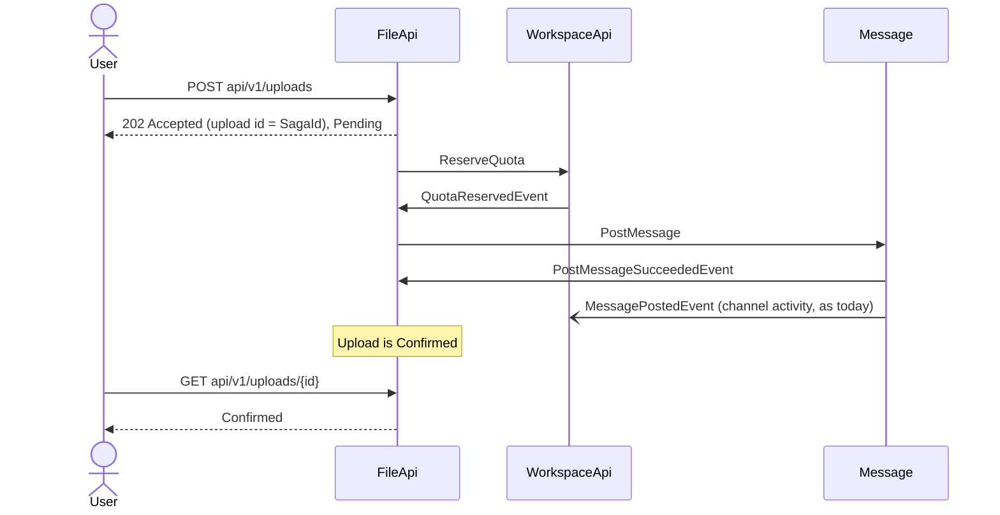
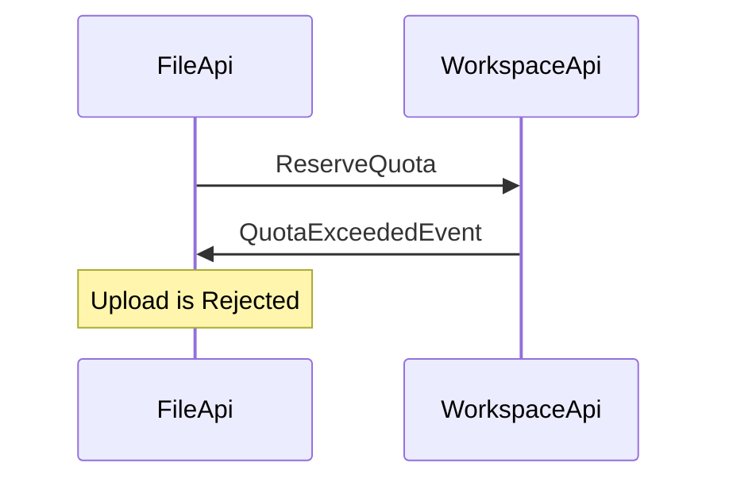
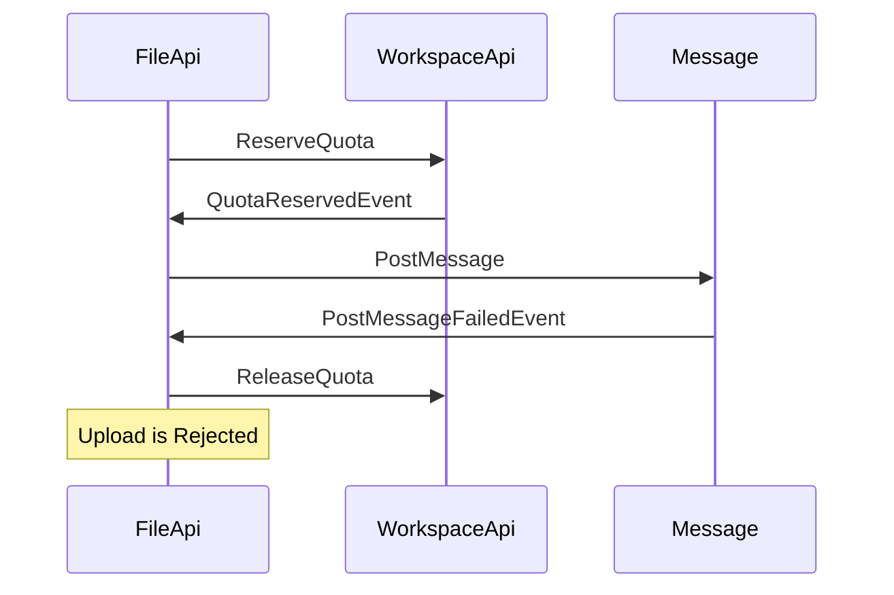
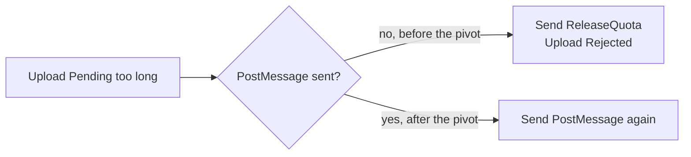

# Upload saga

A user uploads a file to a channel. The workspace has a storage quota, so the upload must be checked against it before
the message with the file is posted. Three services take part, and each one only changes its own database:

| Service      | Owns                                         |
|--------------|----------------------------------------------|
| FileApi      | The upload and its status, and the saga state |
| WorkspaceApi | The workspace's storage limit and used space  |
| Message      | The messages in a channel                     |

FileApi orchestrates the saga. Why orchestration, why FileApi, and why the quota is checked before the message is
posted: see [decisions.md](decisions.md#saga-upload-af-en-fil-der-er-for-stor-til-kvoten).

Every message carries the `SagaId`, which is also the upload id the client gets back. The messages are in
[Bizcord.Contracts/Commands](../src/Bizcord.Contracts/Commands) and [Bizcord.Contracts/Events](../src/Bizcord.Contracts/Events).

## Steps

| Step                 | Service      | Started by        | Success                                           | Failure                                                      | Compensation if a later step fails                    |
|----------------------|--------------|-------------------|---------------------------------------------------|--------------------------------------------------------------|-------------------------------------------------------|
| 1. Store the upload  | FileApi      | `POST api/v1/uploads` | Upload is `Pending`, sends `ReserveQuota`     | 400 or 401, nothing is stored                                | Upload becomes `Rejected`                             |
| 2. Reserve the quota | WorkspaceApi | `ReserveQuota`    | `QuotaReservedEvent`                              | `QuotaExceededEvent`: the saga ends, nothing to compensate   | `ReleaseQuota`                                        |
| 3. Post the message  | Message      | `PostMessage`     | `PostMessageSucceededEvent`, upload is `Confirmed` | `PostMessageFailedEvent`: `ReleaseQuota`, upload `Rejected` | None. Step 3 is the pivot: once the message may be posted, the saga only goes forward |

## Happy path

## Failure: the quota is exceeded

Nothing has been reserved and no message exists, so there is nothing to compensate.

## Failure: the message can't be posted

The quota was reserved in step 2, so it is released again.

## Failure: a service never answers

A background job in FileApi looks for `Pending` uploads that have not moved for too long.

After the pivot the job sends `PostMessage` again instead of rolling back. Message is idempotent on `SagaId`, so the
message is only posted once.

## Duplicates and late replies

- RabbitMQ can deliver a message more than once, so every step is idempotent on `SagaId`:
  - WorkspaceApi reserves or releases at most once per `SagaId`, and answers a repeated `ReserveQuota` with the same
    reply as the first time.
  - Message posts at most once per `SagaId`.
- A reply that arrives after the upload is already `Confirmed` or `Rejected` is logged and ignored.
