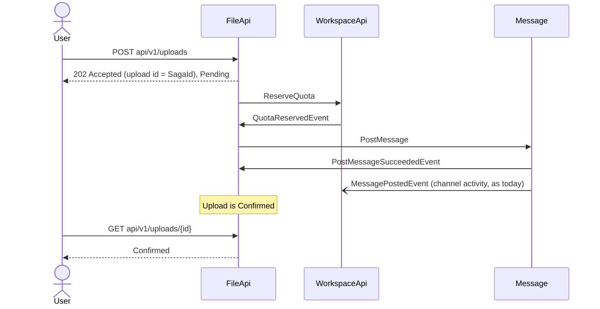
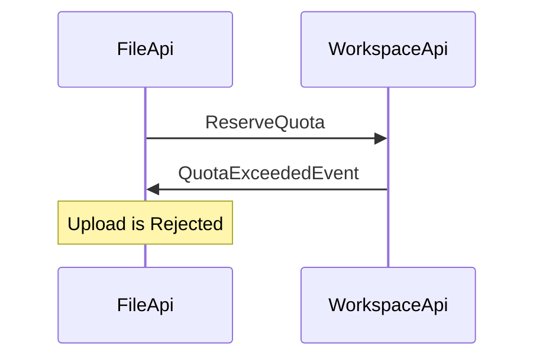
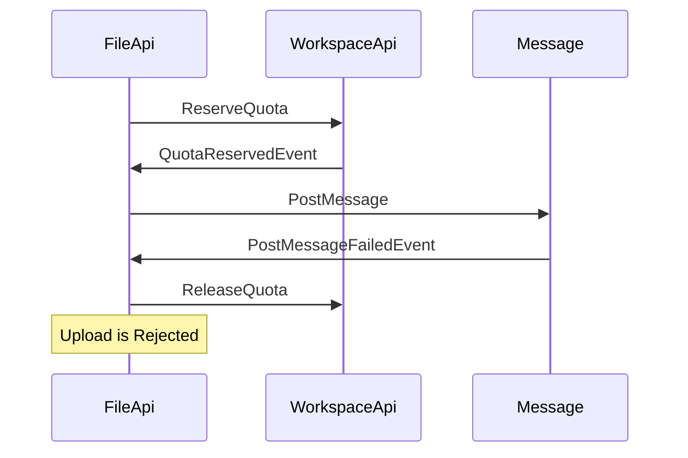
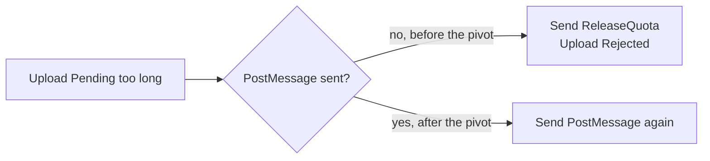

# Upload saga

A user uploads a file to a channel. The workspace has a storage quota, so the upload must be checked against it before
the message with the file is posted. Three services take part, and each one only changes its own database:

| Service      | Owns                                         |
|--------------|----------------------------------------------|
| FileApi      | The upload and its status, and the saga state |
| WorkspaceApi | The workspace's storage limit and used space  |
| Message      | The messages in a channel                     |

FileApi orchestrates the saga. Why orchestration, why FileApi, and why the quota is checked before the message is
posted: see [decisions.md](decisions.md#saga-upload-af-en-fil-der-er-for-stor-til-kvoten).

Every message carries the `SagaId`, which is also the upload id the client gets back. The messages are in
[Bizcord.Contracts/Commands](../src/Bizcord.Contracts/Commands) and [Bizcord.Contracts/Events](../src/Bizcord.Contracts/Events).

## Steps

| Step                 | Service      | Started by        | Success                                           | Failure                                                      | Compensation if a later step fails                    |
|----------------------|--------------|-------------------|---------------------------------------------------|--------------------------------------------------------------|-------------------------------------------------------|
| 1. Store the upload  | FileApi      | `POST api/v1/uploads` | Upload is `Pending`, sends `ReserveQuota`     | 400 or 401, nothing is stored                                | Upload becomes `Rejected`                             |
| 2. Reserve the quota | WorkspaceApi | `ReserveQuota`    | `QuotaReservedEvent`                              | `QuotaExceededEvent`: the saga ends, nothing to compensate   | `ReleaseQuota`                                        |
| 3. Post the message  | Message      | `PostMessage`     | `PostMessageSucceededEvent`, upload is `Confirmed` | `PostMessageFailedEvent`: `ReleaseQuota`, upload `Rejected` | None. Step 3 is the pivot: once the message may be posted, the saga only goes forward |

## Happy path

## Failure: the quota is exceeded

Nothing has been reserved and no message exists, so there is nothing to compensate.

## Failure: the message can't be posted

The quota was reserved in step 2, so it is released again.

## Failure: a service never answers

A background job in FileApi ([StalledUploads](../src/Bizcord.FileApi/Services/StalledUploads.cs)) checks every 10 seconds
for `Pending` uploads that have not moved for 30 seconds (`UploadSaga:CheckInterval` and `UploadSaga:StalledAfter`).

- **Before the pivot** the job rejects the upload and then sends `ReleaseQuota`. The reject only succeeds while
  `PostMessage` still hasn't been sent, so a `QuotaReservedEvent` that arrives at the same moment can't end with a
  posted message for a rejected upload.
- **After the pivot** the job sends `PostMessage` again instead of rolling back. Message is idempotent on `SagaId`, so
  the message is only posted once. The job tries again every 30 seconds until Message answers.

`ReserveQuota` and `ReleaseQuota` go to different queues, so Workspace can get the release first, e.g. when it was down
while the saga timed out. Workspace then stores the release, and the late `ReserveQuota` reserves nothing.

## Duplicates and late replies

- RabbitMQ can deliver a message more than once, so every step is idempotent on `SagaId`:
  - WorkspaceApi reserves or releases at most once per `SagaId`, and answers a repeated `ReserveQuota` with the same
    reply as the first time.
  - Message posts at most once per `SagaId`.
- A reply that arrives after the upload is already `Confirmed` or `Rejected` is logged and ignored.

## Try it

With the stack running (`docker compose up -d`), get a token from the faucet with the scopes `workspace.write`,
`file.write` and `file.read`, create a workspace, and `POST api/v1/uploads` through the gateway. Then follow the upload
with `GET api/v1/uploads/{id}`:

| Path                     | How                                                                                      | Result                                             |
|--------------------------|------------------------------------------------------------------------------------------|----------------------------------------------------|
| Happy path               | An upload that fits the quota (100 MB by default)                                         | `Confirmed`                                        |
| Quota exceeded           | `sizeBytes` bigger than the quota                                                        | `Rejected`, nothing reserved                       |
| Message can't post       | `MESSAGE_STUB_BEHAVIOR=Fail docker compose up -d message-stub`                           | `Rejected`, the quota is released again           |
| Message never answers    | `MESSAGE_STUB_BEHAVIOR=NoReply docker compose up -d message-stub`                        | Stays `Pending`, the job sends `PostMessage` again every 30 s. `Confirmed` once the stub answers again |
| Workspace is down        | `docker compose stop workspace-api` before the upload, start it after a minute         | `Rejected` after 30 s, and nothing is reserved when Workspace comes back |

`docker compose up -d message-stub` without the variable sets it back to `Succeed`.

## Limitations

- FileApi trusts the `workspaceId` and `channelId` in the request. It doesn't check that the user is a member of the
  channel, or that the channel belongs to the workspace. A real File service would ask Workspace first, through the
  internal members endpoint from #72.
- The client sends the file size, and only the metadata is stored (see [decisions.md](decisions.md)).
- FileApi stores the upload and then publishes `ReserveQuota` in two steps. If RabbitMQ is down in between, the upload
  waits for the timeout job. The same goes for the `ReleaseQuota` after a timeout: if that publish is lost, the space
  stays reserved. An outbox would fix both, like #66 describes for WorkspaceApi.
